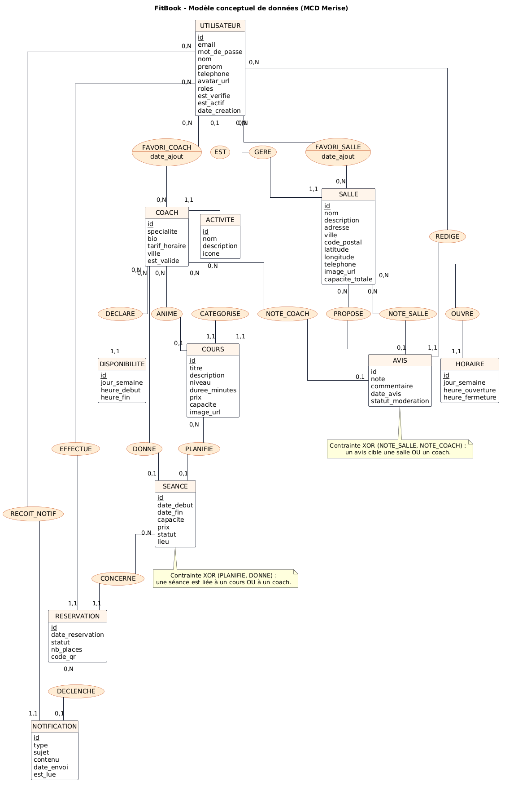
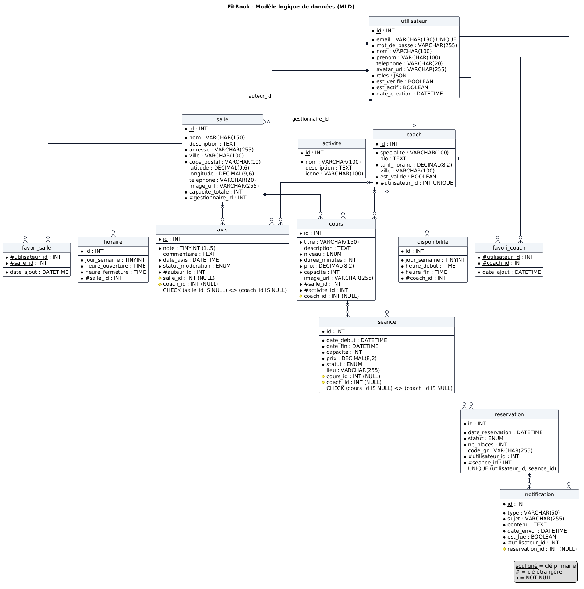
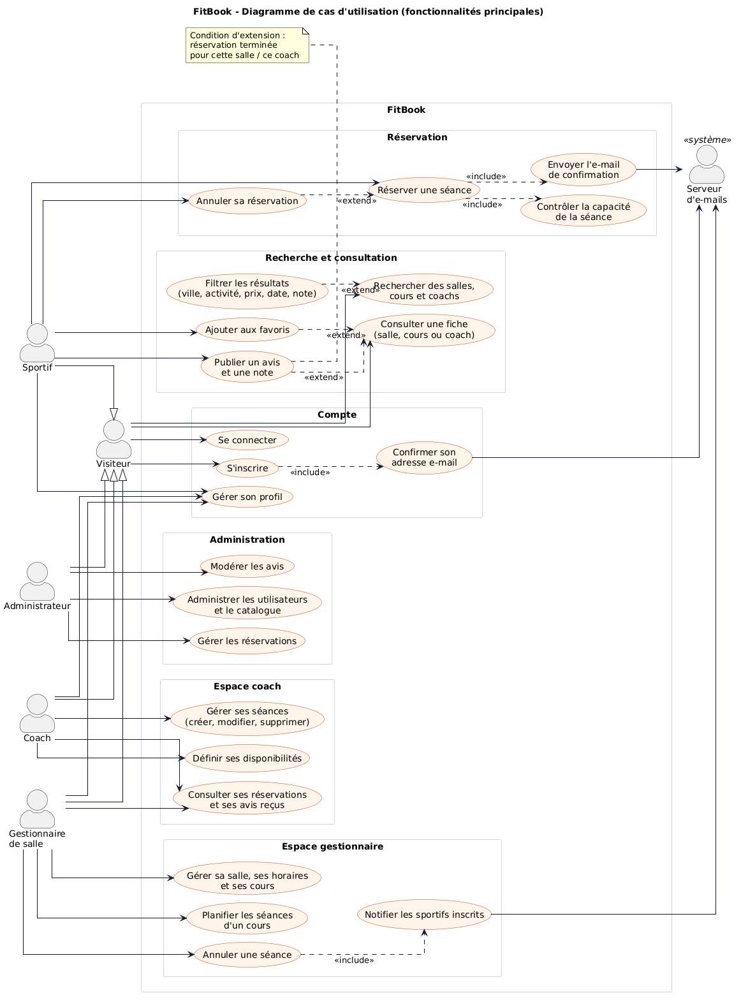
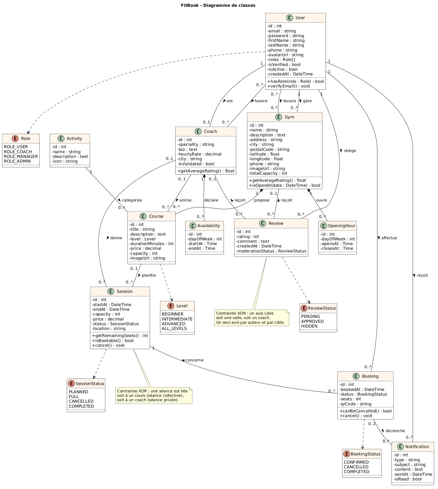

# FitBook – Cahier des charges fonctionnel et technique

> Plateforme de réservation de salles, de cours et de coachs sportifs · Projet Cfitech, 140 h · Trinitas Mudeyi.
>
> **Partie A** : cahier des charges remis par le formateur (texte d'origine).
> **Partie B** : analyse, modélisation et état de réalisation – les modèles et diagrammes sont intégrés au cahier
> comme demandé à la section A.6, et les livrables de la section A.11 y sont référencés.

---

## Partie A – Cahier des charges d'origine

### A.1 Présentation du projet

FitBook est une plateforme web sportive permettant aux utilisateurs de rechercher des salles, des cours et des coachs,
puis de réserver une séance. Les professionnels disposent d'un espace pour gérer leurs activités et leurs réservations.
La plateforme inclut des comptes utilisateurs, des filtres avancés, des rôles, des opérations CRUD, une administration
et une gestion sécurisée des données.

### A.2 Objectifs

- Créer une interface moderne, ergonomique et responsive sur ordinateur, tablette et mobile.
- Permettre une recherche rapide de salles, cours et coachs au moyen d'une barre de recherche et de filtres avancés.
- Gérer les séances, les disponibilités, les calendriers, les réservations, les favoris et les avis.
- Sécuriser l'accès grâce à l'authentification, la confirmation de l'adresse e-mail et les permissions selon le rôle.

### A.3 Types d'utilisateurs et fonctionnalités

**3.1 Sportif** – créer et modifier son profil ; rechercher et filtrer des salles, cours et coachs et consulter leurs
informations ; réserver une séance ou un cours, consulter l'historique et annuler ses réservations ; enregistrer des
favoris ; publier des avis et attribuer des notes.

**3.2 Coach** – gérer son profil professionnel ; créer, modifier et supprimer ses séances ; définir ses horaires et ses
disponibilités dans un calendrier ; consulter ses réservations et les avis reçus.

**3.3 Salle / gestionnaire** – gérer les informations de la salle, les cours et les activités ; définir horaires,
capacités et disponibilités ; consulter et gérer le calendrier, les réservations et les avis.

**3.4 Administrateur** – administrer les utilisateurs, salles, coachs et activités ; gérer les réservations ; modérer
les avis et les notes.

### A.4 Fonctionnalités transversales obligatoires

- Inscription, connexion et confirmation de l'adresse e-mail.
- Gestion des permissions selon le rôle.
- Barre de recherche et filtres avancés.
- Gestion des favoris, avis et notes.
- Calendrier des séances et disponibilités.
- Réservations avec contrôle de capacité.
- Notifications par e-mail liées aux réservations.
- Formulaires validés côté serveur et opérations CRUD.

### A.5 Technologies du projet

**5.1 Frontend** – Angular 21 ; HTML et CSS (SCSS, Bootstrap ou Tailwind possibles) ; bibliothèques compatibles avec
Angular autorisées ; interfaces responsives et adaptées aux différents rôles.

**5.2 Backend et base de données** – PHP avec le framework Symfony ; base de données MySQL avec un utilisateur dédié,
différent de « root », protégé par un mot de passe ; API pour les fonctionnalités métier et communication avec le
frontend ; tests des API à l'aide de Postman / Newman ; sauvegardes de la base de données aux étapes demandées.

### A.6 Conception et analyse

- Rédiger les user stories des fonctionnalités et des quatre rôles.
- Créer les wireframes et maquettes dans Figma ou Canva : au minimum trois écrans principaux et leurs variantes
  responsives pertinentes.
- Préparer un MCD avec JMerise ou un outil équivalent.
- Déduire un MLD cohérent avec le MCD.
- Créer les diagrammes de cas d'utilisation (Use Cases) et de classes avec StarUML ou un équivalent.
- Intégrer les modèles et diagrammes au cahier des charges.
- Faire valider les user stories, les maquettes Figma et le MCD avant de commencer le développement.

### A.7 Gestion du projet et versionnement

- Créer le tableau Trello avant le développement.
- Créer le dépôt GitHub avant le développement.
- Utiliser le workflow GitFlow.
- Effectuer au minimum trois commits par jour de travail.
- Créer au moins une pull request tous les trois jours.
- Conserver un suivi permettant de retracer l'avancement du projet.

### A.8 Déroulement de la réalisation

**Étape 1 – Préparation et validation** : définir les user stories et les besoins de chaque rôle ; créer les maquettes
et les modèles de données, puis les faire valider ; initialiser Trello, GitHub et le workflow GitFlow.

**Étape 2 – Structure technique** : initialiser Angular 21, Symfony et MySQL ; configurer les accès à la base de données
et les rôles ; mettre en place l'authentification et la confirmation e-mail.

**Étape 3 – Fonctionnalités métier** : développer les écrans de recherche, de consultation et de réservation ; créer
les espaces sportif, coach, gestionnaire et administrateur ; intégrer favoris, avis, notes, calendrier et notifications.

**Étape 4 – Validation et livraison** : tester les fonctionnalités, les permissions, les formulaires et les capacités ;
effectuer les sauvegardes et vérifier le déploiement ; préparer la démonstration des fonctionnalités et des résultats.

### A.9 Tests, sécurité et qualité

- Tests unitaires et tests d'intégration.
- Tests d'API avec Postman / Newman.
- Validation des formulaires côté backend.
- Contrôle des droits et des permissions par rôle.
- Protection des données d'authentification.
- Vérification des capacités et prévention des réservations au-delà des places disponibles.
- Sauvegardes de la base de données.
- Vérification du fonctionnement du site et de sa connexion à la base de données après déploiement.

### A.10 Fonctionnalités complémentaires (bonus)

Carte interactive ; recherche par distance ; notification avant une séance ; statistiques ; QR code de confirmation
de réservation ; autres améliorations créatives adaptées à FitBook.

### A.11 Livrables du projet

- Application FitBook fonctionnelle et responsive.
- Cahier des charges contenant l'analyse et la modélisation.
- User stories, maquettes Figma/Canva, MCD, MLD, Use Cases et diagramme de classes.
- Code source suivi dans GitHub et tâches suivies dans Trello.
- Jeux de tests, résultats des vérifications et sauvegardes de base de données.
- Présentation finale du projet (PowerPoint, Canva, Figma ou équivalent) : technologies, fonctionnalités,
  organisation, tests et résultats.

---

## Partie B – Analyse, modélisation et réalisation

### B.1 Livrables d'analyse (section A.6)

| Livrable | Fichier / lien | Outil |
|----------|----------------|-------|
| User stories (42 : 35 Must, 2 Should, 5 Could ; 4 rôles + système) | [01-user-stories.md](01-user-stories.md) | Markdown |
| Wireframes basse fidélité (4 écrans, desktop + mobile) et maquettes haute fidélité (3 écrans) | https://www.figma.com/design/3zUgXqVLVCvrWmTGebKzxF | Figma |
| MCD (Merise) | [02-mcd-mld.md](02-mcd-mld.md) · [diagrammes/mcd.png](diagrammes/mcd.png) · FigJam https://www.figma.com/board/VhYQ5m25lANl7sED0Ap9jP · import JMerise par rétro-conception de [fitbook.sql](fitbook.sql) | PlantUML, FigJam, JMerise |
| MLD déduit du MCD (13 tables) | [02-mcd-mld.md](02-mcd-mld.md) · [diagrammes/mld.png](diagrammes/mld.png) · script SQL [fitbook.sql](fitbook.sql) | PlantUML, MySQL |
| Diagramme de cas d'utilisation (include / extend) | [diagrammes/use-cases.png](diagrammes/use-cases.png) · fichier natif StarUML [diagrammes/fitbook.mdj](diagrammes/fitbook.mdj) | StarUML |
| Diagramme de classes | [diagrammes/classes.png](diagrammes/classes.png) · [diagrammes/fitbook.mdj](diagrammes/fitbook.mdj) | StarUML |
| Contrat de l'API REST | [04-api.md](04-api.md) | Markdown |
| Tableau Trello | https://trello.com/b/t2CAAITw/fitbook | Trello |
| Dépôt GitHub (GitFlow) | https://github.com/Trinitas-tech/fitbook_trinitas | GitHub |

User stories, maquettes Figma et MCD ont été validés par le formateur avant le début du développement (27/10/2026).

#### MCD

#### MLD

#### Cas d'utilisation

#### Diagramme de classes

### B.2 Architecture technique (section A.5)

| Couche | Choix | Détail |
|--------|-------|--------|
| Frontend | Angular 21 | composants standalone, signals, SCSS, charte Figma (orange `#F97316`, bleu nuit `#0F172A`, police Inter), responsive desktop / tablette / mobile, carte Leaflet |
| Backend | Symfony 7.4 (PHP 8.3) | API REST JSON, authentification JWT (LexikJWT), Voters par rôle et par propriétaire, validation serveur (Symfony Validator), Symfony Mailer (e-mails HTML en français), commandes planifiées |
| Base de données | MySQL 9 (dev) / MySQL alwaysdata (prod) | utilisateur dédié `fitbook` (jamais `root`), moteur InnoDB forcé, contraintes CHECK (séance liée à un cours **ou** à un coach, avis sur salle **ou** coach), verrou `SELECT … FOR UPDATE` sur la séance à la réservation |
| Tests | PHPUnit 12, Postman / Newman, Vitest | voir B.4 |
| Hébergement | alwaysdata (Apache + PHP 8.3) | frontend et API sur la même origine, voir [05-deploiement.md](05-deploiement.md) |

### B.3 Couverture fonctionnelle

| Exigence du cahier (A.3 / A.4 / A.10) | User stories | Réalisation |
|---------------------------------------|--------------|-------------|
| Inscription, connexion, confirmation de l'adresse e-mail | US-01 à US-04 | `POST /auth/register` + e-mail de confirmation (lien 24 h), `GET /auth/verify-email`, `POST /auth/login` (JWT, 403 tant que non vérifié), mot de passe oublié / réinitialisation (lien 1 h) |
| Permissions selon le rôle | US-06 | `access_control` par préfixe (`/admin`, `/manager`, `/coach`) + 5 Voters (réservation, salle, cours, séance, avis) ; guards Angular `authGuard` / `roleGuard` |
| Barre de recherche et filtres avancés | US-10, US-11 | `GET /search` (mot-clé, ville, activité, niveau, prix max, date, note min, type), URL partageable côté Angular |
| Fiches salle / coach / cours | US-12 à US-14 | horaires, cours, avis approuvés, note moyenne, disponibilités, séances à venir avec places restantes |
| Réservations avec contrôle de capacité | US-15, US-16, US-17, US-60 | transaction + verrou, refus « Séance complète », une réservation par sportif et par séance, annulation jusqu'à 2 h avant, historique à venir / passé |
| Favoris, avis et notes | US-18, US-19, US-62 | favoris salles / coachs, avis (1 à 5) après une réservation terminée, un avis par salle / coach, moyenne recalculée (1 décimale) |
| Calendrier des séances et disponibilités | US-32, US-33, US-41, US-43, US-44 | disponibilités hebdomadaires du coach, horaires d'ouverture de la salle, planification unitaire ou récurrente, vues calendrier coach / gestionnaire |
| Notifications par e-mail liées aux réservations | US-61, US-45 | confirmation, annulation par le sportif, annulation de séance par le pro, trace en table `notification` ; vérifié dans Mailtrap (voir B.4) |
| Formulaires validés côté serveur et CRUD | toutes | contraintes Symfony Validator sur chaque corps JSON (400 + liste des erreurs), CRUD salles / cours / séances / activités / utilisateurs / avis |
| Espace coach | US-30 à US-35 | profil pro (visible une fois complet et validé), CRUD séances (refus de suppression si réservations), disponibilités, calendrier, participants, avis reçus |
| Espace gestionnaire | US-40 à US-46 | fiche salle, horaires, cours, séances, calendrier et réservations, annulation de séance (e-mails), avis |
| Espace administrateur | US-50 à US-53 | utilisateurs (rôle, désactivation), validation des coachs, catalogue, réservations (annulation forcée), modération des avis (un avis masqué sort de la moyenne) |
| Séance passée en « terminée » | US-63 | commande `app:sessions:close` (planifiée toutes les heures) |
| **Bonus** carte interactive + distance | US-21 | carte Leaflet, géolocalisation navigateur, tri par distance (Haversine) |
| **Bonus** notification avant une séance | US-20 | commande `app:bookings:remind` (rappel 24 h, sans doublon) |
| **Bonus** statistiques | US-36, US-54 | tableau de bord coach (taux de remplissage, note…) et graphiques admin (inscriptions et réservations par mois, top activités / salles) |
| **Bonus** QR code de confirmation | US-22 | QR code SVG dans « Mes réservations », code `FB-XXXXXXXXXXXX` |
| **Bonus** export CSV des réservations | US-44 | `GET /manager/gyms/{id}/bookings/export` |

Les 42 user stories (35 Must, 2 Should, 5 Could) sont réalisées.

### B.4 Tests, sécurité et qualité (section A.9)

Détail et résultats : [06-tests.md](06-tests.md).

- **Tests unitaires** (PHPUnit, `backend/tests/Unit`) : entités (capacité, statut, délai d'annulation, distance,
  QR code) et `BookingService` avec doublures (capacité, doublon, séance passée / annulée, réactivation, annulation forcée).
- **Tests d'intégration** (PHPUnit `WebTestCase`, `backend/tests/Functional`, base `fitbook_test` recréée + fixtures) :
  inscription → e-mail → confirmation → connexion, validation des formulaires (400), catalogue et filtres,
  réservation / annulation / surréservation (409), permissions 401 / 403 par rôle et par propriétaire, désactivation d'un compte.
- **Tests d'API** Postman / Newman (`postman/`) : 18 requêtes, 35 assertions (listes OK/KO, connexion KO/OK, CRUD coach,
  séance, suppression admin).
- **Frontend** : Vitest (`npm test`).
- **Sécurité** : mots de passe hashés (algorithme auto), JWT signé RS256, message de connexion générique, compte non
  vérifié / désactivé refusé (`UserChecker`), utilisateur MySQL dédié, CORS restreint, secrets hors dépôt (`.env.local`, clés JWT).
- **E-mails** : transport SMTP Mailtrap (sandbox) vérifié le 29/10/2026 – e-mail de confirmation d'inscription et e-mail
  de test acceptés par le serveur (réponse `250`), trace en table `notification`.
- **Sauvegardes** : dumps MySQL dans [sauvegardes/](sauvegardes/) (étape 2 : schéma + fixtures ; étape 4 : avant / après déploiement).

### B.5 Gestion de projet (section A.7)

- Trello créé avant le développement (une carte par user story, colonnes À faire / En cours / Terminé).
- GitHub + GitFlow : `main` (livraison), `develop` (intégration), branches `feature/init-stack`,
  `feature/integration-frontend`, `feature/bonus-could-stories`, `feature/livrables-natifs`, `feature/tests-deploiement` ;
  pull requests vers `develop`, puis `release` vers `main`.
- Au moins 3 commits par jour de travail (voir `git log`).

### B.6 Déploiement et livraison (sections A.8 étape 4, A.11)

- Procédure, variables et vérifications après mise en ligne : [05-deploiement.md](05-deploiement.md).
- Présentation finale (support de soutenance) : [07-presentation.md](07-presentation.md).
