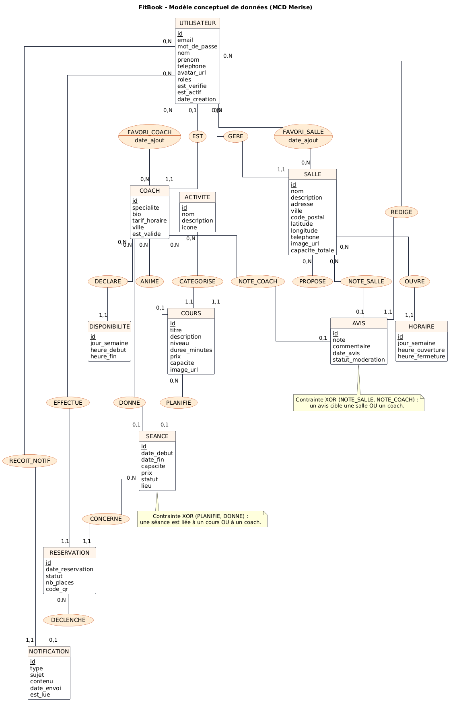
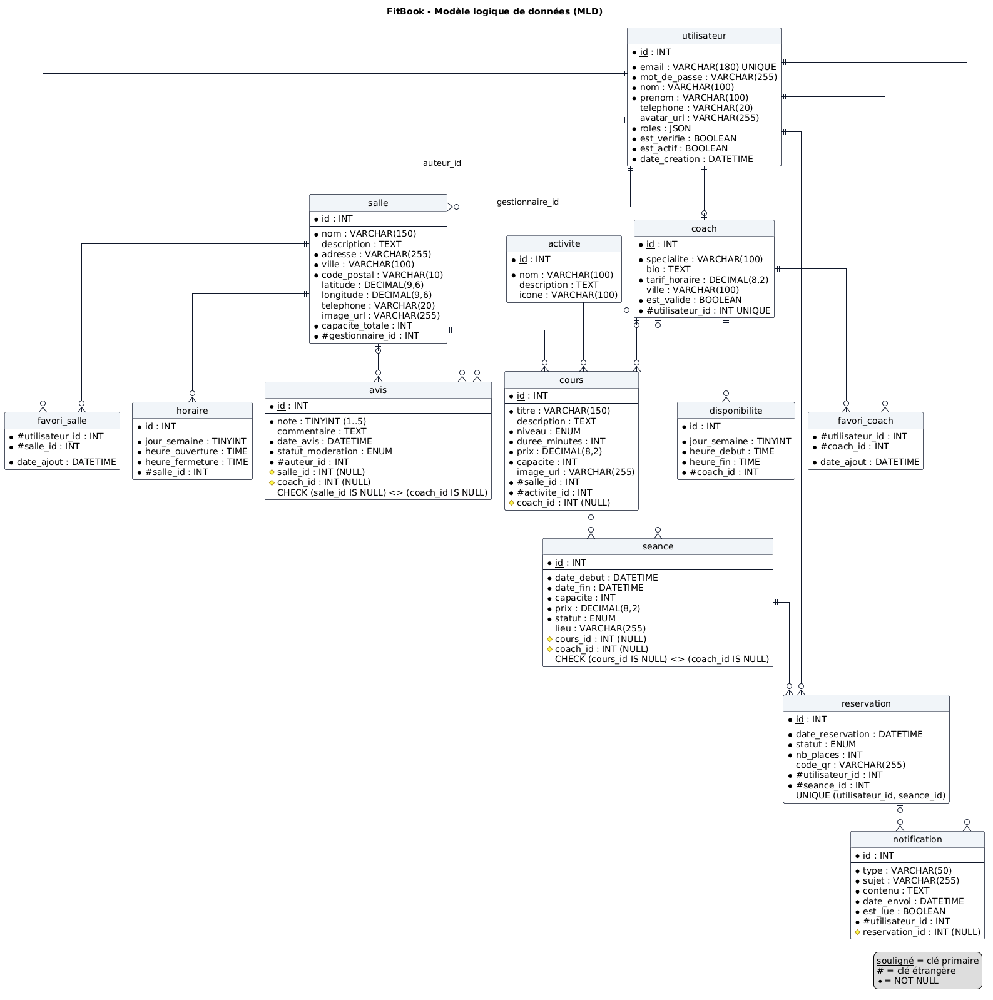
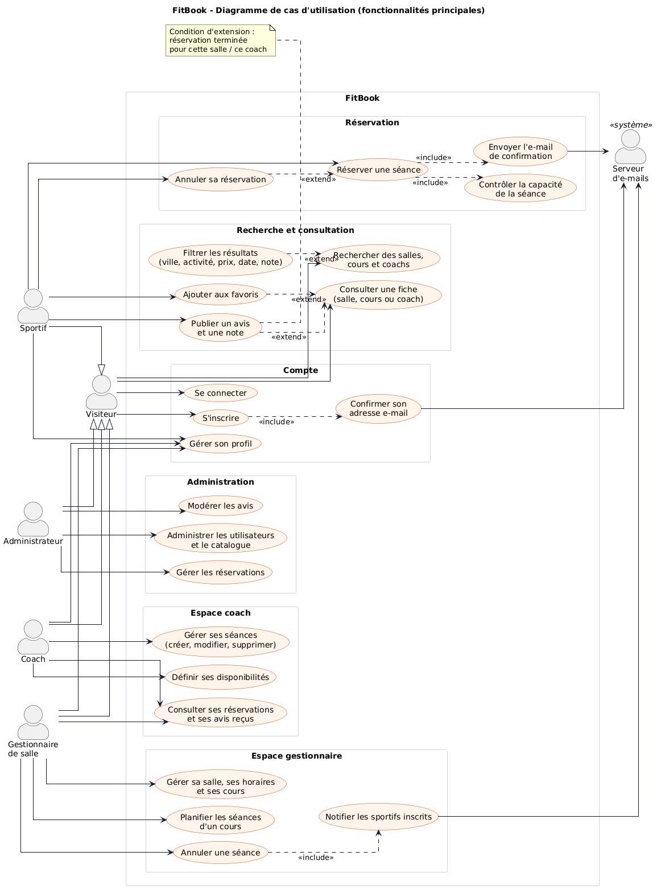
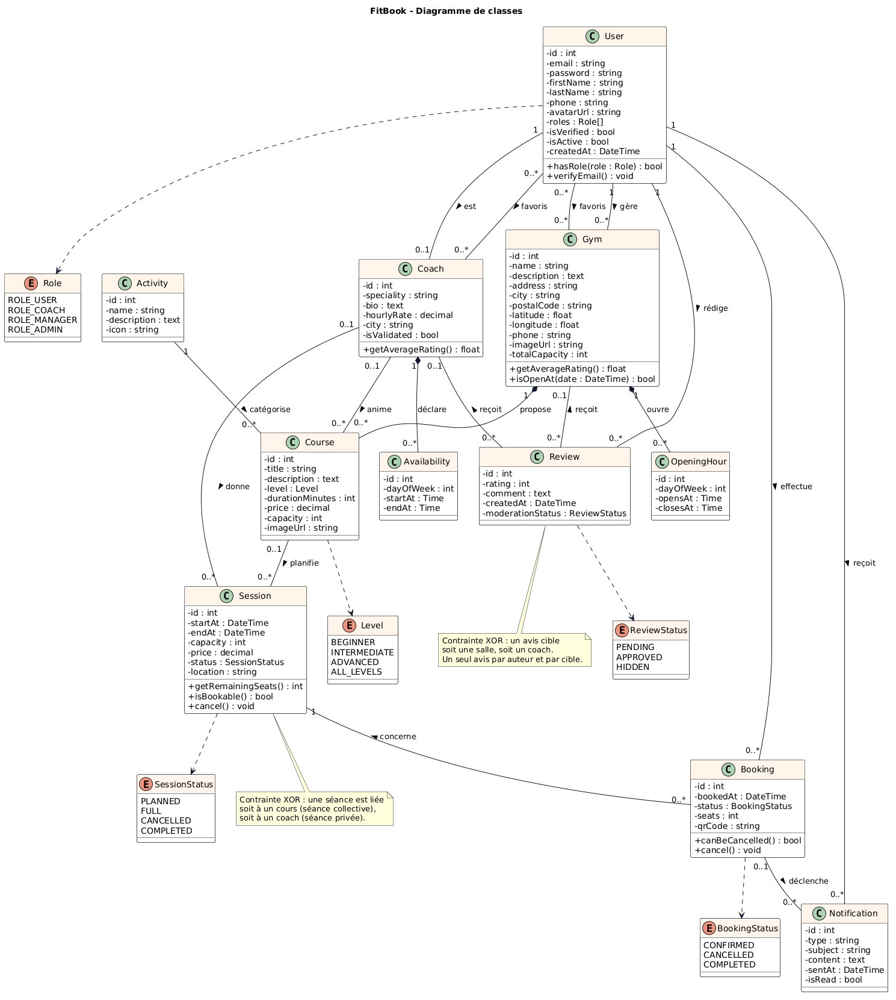

# FitBook – Diagrammes (MCD, MLD, cas d'utilisation, classes)

> Les quatre diagrammes sont rédigés en **PlantUML** (équivalent de StarUML / JMerise accepté
> par le cahier des charges) dans `docs/diagrammes/*.puml` et rendus en PNG + SVG.
> Pour re-générer après modification :
> `curl -X POST https://kroki.io/plantuml/png --data-binary @docs/diagrammes/mcd.puml -o docs/diagrammes/mcd.png`

| Diagramme | Source | Image |
|-----------|--------|-------|
| MCD (Merise) | `diagrammes/mcd.puml` |  |
| MLD (relationnel) | `diagrammes/mld.puml` |  |
| Cas d'utilisation | `diagrammes/use-cases.puml` |  |
| Classes | `diagrammes/classes.puml` |  |

## Fichier natif StarUML

Les diagrammes de cas d'utilisation et de classes existent aussi au format natif StarUML :
**`diagrammes/fitbook.mdj`** (un projet, deux diagrammes : « Diagramme de classes » et « Cas d'utilisation »).
Il s'ouvre dans StarUML (Fichier > Ouvrir) et reste entièrement modifiable.

Le fichier est généré par le script `diagrammes/outils/gen-staruml.js` (Node.js), ce qui garantit sa
cohérence avec le code (noms des entités, attributs, méthodes, multiplicités) :

```bash
node docs/diagrammes/outils/gen-staruml.js docs/diagrammes/fitbook.mdj
# export des images par StarUML lui-même (vérifie que le fichier se charge)
"C:\Program Files\StarUML\StarUML.exe" image docs/diagrammes/fitbook.mdj -f png -o "out/<%=element.name%>.png"
```

Le diagramme de classes reprend les 12 entités Doctrine (classes en anglais, tables en français dans le MLD),
les 4 énumérations, les compositions (`Gym` – `Course` / `OpeningHour`, `Coach` – `Availability`), les deux
associations de favoris et les notes de contrainte XOR. Le diagramme de cas d'utilisation reprend les 5 acteurs,
l'acteur secondaire « Serveur d'e-mails », les 6 paquetages, les 4 `include` et les 4 `extend`.

## Fichier natif JMerise (MCD)

Le format `.mcd` de JMerise est une sérialisation binaire Java : il ne peut pas être généré par script.
Il s'obtient en quelques minutes par rétro-conception du script `fitbook.sql` (procédure détaillée en
section 6 de [02-mcd-mld.md](02-mcd-mld.md)), puis en ajoutant à la main les deux contraintes XOR.

## 1. Diagramme de cas d'utilisation

Acteurs : **Visiteur**, **Sportif**, **Coach**, **Gestionnaire de salle**, **Administrateur**,
plus l'acteur secondaire **Serveur d'e-mails** (système externe). Sportif, Coach, Gestionnaire
et Administrateur héritent du Visiteur : ils peuvent rechercher et consulter comme lui.

Les cas d'utilisation sont regroupés en six paquetages : Compte, Recherche et consultation,
Réservation, Espace coach, Espace gestionnaire, Administration.

### Relations « include » (comportement obligatoire, toujours exécuté)

| Cas de base | include | Justification |
|-------------|---------|---------------|
| S'inscrire | Confirmer son adresse e-mail | Le compte n'est actif qu'après confirmation (US-02). |
| Réserver une séance | Contrôler la capacité de la séance | Aucune réservation sans vérification des places (US-60). |
| Réserver une séance | Envoyer l'e-mail de confirmation | Notification systématique (US-61). |
| Annuler une séance | Notifier les sportifs inscrits | Tous les inscrits sont prévenus (US-45). |

### Relations « extend » (comportement optionnel ou conditionnel)

| Extension | étend | Condition |
|-----------|-------|-----------|
| Filtrer les résultats | Rechercher des salles, cours et coachs | Le sportif choisit d'affiner (US-11). |
| Ajouter aux favoris | Consulter une fiche | Utilisateur connecté (US-18). |
| Publier un avis et une note | Consulter une fiche | Réservation terminée pour cette salle / ce coach (US-19). |
| Annuler sa réservation | Réserver une séance | Plus de 2 h avant le début (US-17). |

## 2. Diagramme de classes

Classes (entités Doctrine) : `User`, `Coach`, `Gym`, `Activity`, `Course`, `Session`,
`OpeningHour`, `Availability`, `Booking`, `Review`, `Notification` et les énumérations
`Role`, `Level`, `SessionStatus`, `BookingStatus`, `ReviewStatus`.

Points notables :
- `User` – `Coach` : association 1 – 0..1 (un coach est un utilisateur avec un profil pro).
- `Gym` compose ses `Course` et `OpeningHour` ; `Coach` compose ses `Availability`
  (suppression en cascade).
- `Session` est liée à un `Course` **ou** à un `Coach` (contrainte XOR, note sur le diagramme).
- `Review` cible une `Gym` **ou** un `Coach` (XOR), un seul avis par auteur et par cible.
- Favoris : deux associations many-to-many `User` – `Gym` et `User` – `Coach`.
- Méthodes métier : `Session.getRemainingSeats()`, `Session.isBookable()`,
  `Booking.canBeCancelled()`, `Gym.getAverageRating()`, `Coach.getAverageRating()`.

## 3. MCD et MLD

Le détail des entités, associations, cardinalités et règles de passage est dans
[02-mcd-mld.md](02-mcd-mld.md). Le MCD PlantUML reprend la notation Merise (entités en
rectangle, associations en ovale, cardinalités min,max) ; le MLD montre les tables avec clés
primaires soulignées, clés étrangères préfixées `#`, contraintes `UNIQUE` et `CHECK`.
